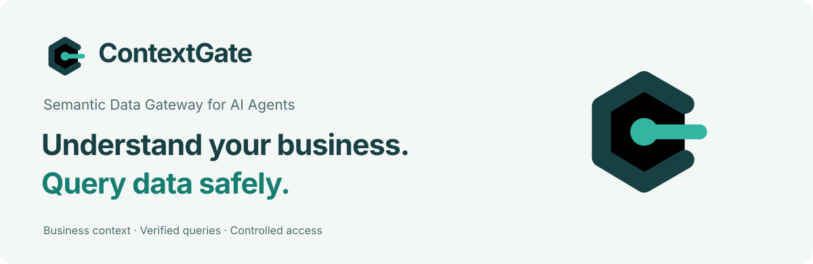
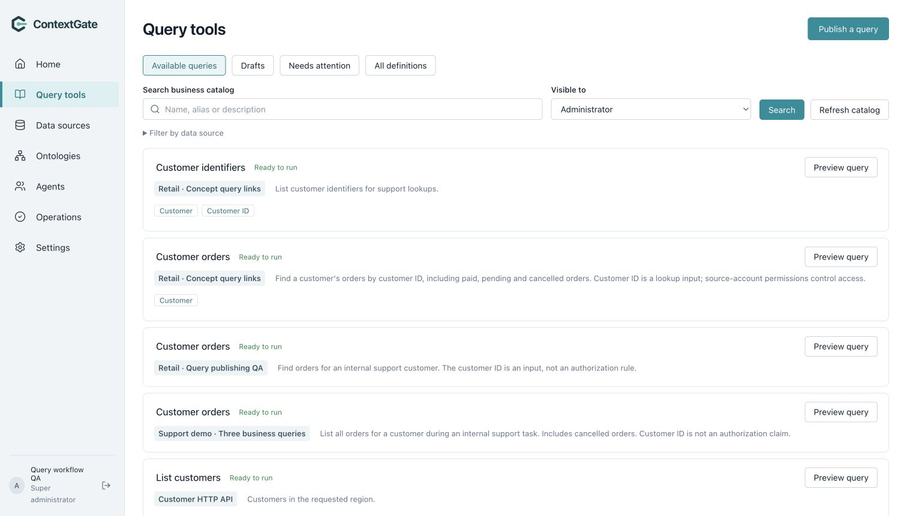

# ContextGate

[English](README.md) · [文档首页](docs/README.zh-CN.md) · [下载 v0.8.1](https://github.com/SamuelSupe/contextGate/releases/tag/v0.8.1)

**Agent 语义数据网关**

ContextGate 将已有业务查询发布为经过验证、可授权、可追溯的 Agent 工具。管理员接入来源、说明查询、完成验证并发布；用户在已有 Agent 客户端中找到获准使用的查询，填入参数即可执行。

业务定义与共享本体按需引入，查询结果保留原生结构；产品不提供知识图谱实例存储或事实推理引擎。Go 实现，内嵌中英文管理 UI，运行时无需 Node.js。

## 选择适合你的文档

| 你要做什么 | 从这里开始 |
| --- | --- |
| 通过 Agent 查询已有服务中的数据 | [用户指南](docs/user-guide.zh-CN.md)：接入、查找查询、理解结果、处理错误 |
| 部署服务，或向他人提供查询能力 | [管理员指南](docs/admin-guide.zh-CN.md)：安装、发布、授权、运维 |
| 修改代码或复现验证 | [贡献指南](CONTRIBUTING.md)：开发、验收和发行资料 |

Web 界面是管理控制台。查询用户通过 `/mcp` 使用服务，无需控制台账号。`/mcp/config` 是管理员专用的配置 MCP 入口。

*真实运行的管理控制台，截图使用隔离数据库与示例数据。*

## 能做什么

| 能力 | 提供的行为 |
| --- | --- |
| 经过验证的查询 | 为已有 SQL 或固定读取 API 声明参数契约，试跑并按明确版本发布 |
| 业务上下文 | 描述术语与指标，按需复用共享实体及各来源映射 |
| 受控访问 | Agent 数据源授权、到期、暂停、轮换、撤销、OAuth，以及可选的仅模板模式 |
| 有界原生读取 | 对 SQL、文档、键值、搜索、图、时序和 HTTP API 来源执行只读保护、超时、取消与结果限制 |
| 原生结果 | 保留大整数、Decimal、二进制及原生数据结构 |
| 管理与运维 | 具名账号、加密凭证、审计及 OTLP 上报、健康检查和备份恢复 |

[支持矩阵](docs/support-matrix.zh-CN.md)列出实际验证的产品、版本与限制。Snowflake、Databricks SQL、BigQuery 和 Redshift 属于[云数仓预览](docs/cloud-warehouses.zh-CN.md)，尚无真实云环境验证。

## 部署一个服务

[ContextGate 0.8.1](https://github.com/SamuelSupe/contextGate/releases/tag/v0.8.1) 提供 Linux **arm64 / amd64** 发行包，内含 UI、C++ 运行库、文档、示例和校验文件，要求 glibc ≥ 2.36 及 PostgreSQL 元数据库。macOS 可通过 Docker / OrbStack 运行服务。

先按[安装指南](docs/install.zh-CN.md)启动，再完成[管理员首次配置](docs/getting-started.zh-CN.md)。可用[三个查询的客服示例](examples/query-publishing/README.zh-CN.md)起步。已有部署请先阅读[升级说明](docs/releases/0.8.1.zh-CN.md#兼容与升级)。

## 项目信息

产品原名 **MCP DB Hub**。主命令为 `contextgate`，兼容 `mcpdbhub` 别名、已有 `MCPDBHUB_*` 配置和遥测属性。详见[品牌与兼容说明](docs/brand/README.zh-CN.md)。

[报告问题](https://github.com/SamuelSupe/contextGate/issues/new/choose) · [安全反馈](SECURITY.md) · [更新记录](CHANGELOG.md) · [架构](docs/architecture.zh-CN.md)

ContextGate 采用 [Apache License 2.0](LICENSE) 许可证。归属声明见 [NOTICE](NOTICE)，依赖许可证见[第三方声明](THIRD_PARTY_NOTICES.md)。
